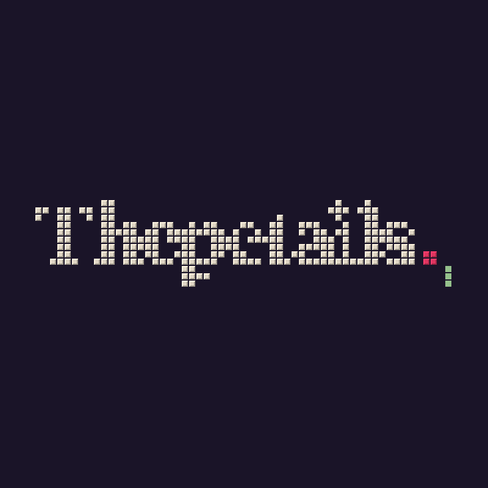

  

<h2 align="center">We're building Periquito.</h2>

An agentic storyteller that turns the life of a real, specific animal into a book a family keeps forever. 
Named after a real dog. Invents the form, never the facts.

  <a href="https://thepetails.com">thepetails.com</a> ·
  <a href="https://instagram.com/thepetailsco">Instagram</a> ·
  Miami, FL

---

**Open from The Petails.** We'll share the boring parts we got right. First up: how we ship Cloudflare Workers only from GitHub, with tests green, every version tagged and the rollback saved before each deploy.

The family is the author. The pet is the protagonist. Periquito is the press.
